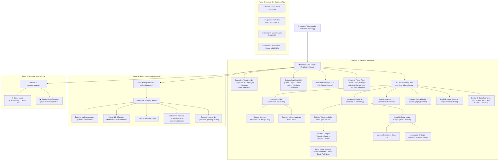
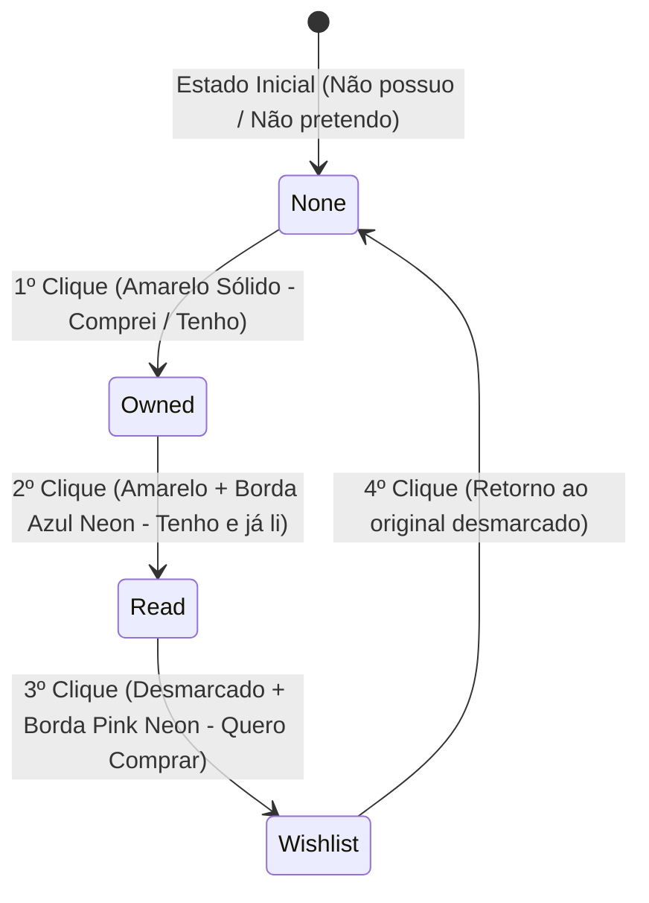
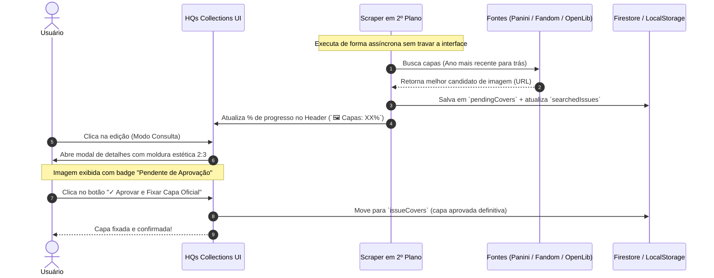

# 🏛️ Arquitetura do Sistema: HQs Collections `v1.1.0`

## 1. Visão Geral
O **HQs Collections** é um sistema projetado para colecionadores de quadrinhos com foco em extrema agilidade no ambiente mobile ("Mobile First"). A aplicação opera em **tela única**, minimizando cliques, eliminando navegações desnecessárias, agrupando edições em blocos táteis de 10 em 10, categorizando coleções por Tipo e Editora, permitindo ordenação personalizada com **Drag & Drop**, títulos específicos por fascículo, suporte a início em edições avançadas (`startFrom`), **ciclo interativo de 4 estágios com destaque em neon**, **scraper de capas em segundo plano com aprovação visual** e **indicador de progresso no cabeçalho**.

---

## 2. Diagrama de Fluxo e Componentes

---

## 3. Ciclo de 4 Estágios da Edição (Modo Edição)

---

## 4. Fluxo de Scraping e Curadoria de Capas

---
*Padrão de excelência técnica: Google Antigravity & SENAI Ourinhos Edition*
