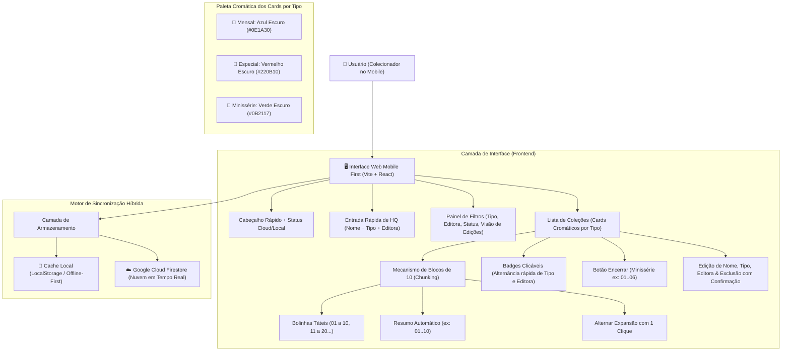

# 🏛️ Arquitetura do Sistema: HQ Tracker

## 1. Visão Geral
O **HQ Tracker** é um sistema projetado para colecionadores de quadrinhos com foco em extrema agilidade no ambiente mobile ("Mobile First"). A aplicação opera em **tela única**, minimizando cliques, eliminando navegações desnecessárias, agrupando edições em blocos táteis de 10 em 10 e categorizando coleções por Tipo e Editora com paletas cromáticas temáticas.

---

## 2. Diagrama de Fluxo e Componentes

---

## 3. Lógica dos Filtros e Modos de Visualização

1. **Filtro de Tipo:** `Todos` | `Mensal` | `Especial` | `Minissérie`
2. **Filtro de Editora:** `Todas` | `Marvel` | `DC` | `Vertigo` | `Outras`
3. **Filtro de Status:** `Todos` | `Em Andamento` | `Encerrados`
4. **Modo de Visualização das Edições:**
   * **Todas as Edições:** Exibe o conjunto completo de 10 botões do bloco.
   * **Somente que Tenho:** Oculta números não adquiridos, exibindo apenas as edições já colecionadas.
   * **Somente Faltantes:** Destaca exclusivamente os números pendentes para aquisição, com estilo visual de alerta (`red-950/40` com borda `red-500/50`).

---
*Padrão de excelência técnica: Google Antigravity & SENAI Ourinhos Edition*
