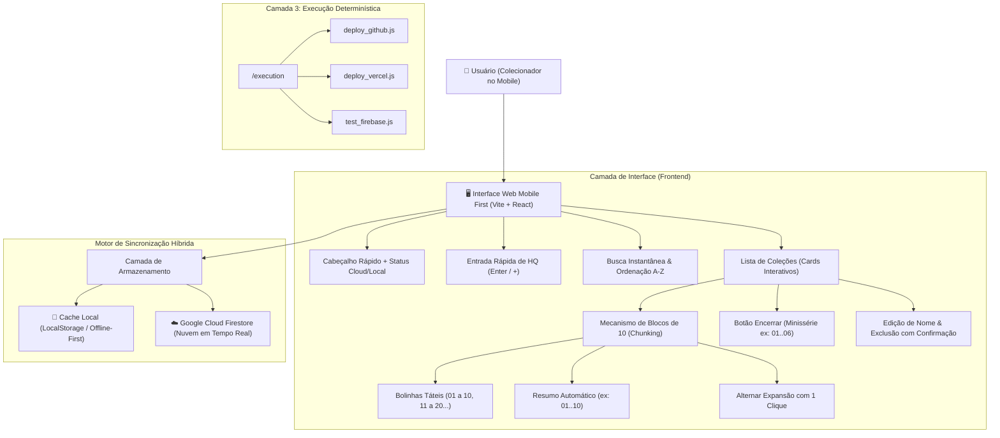
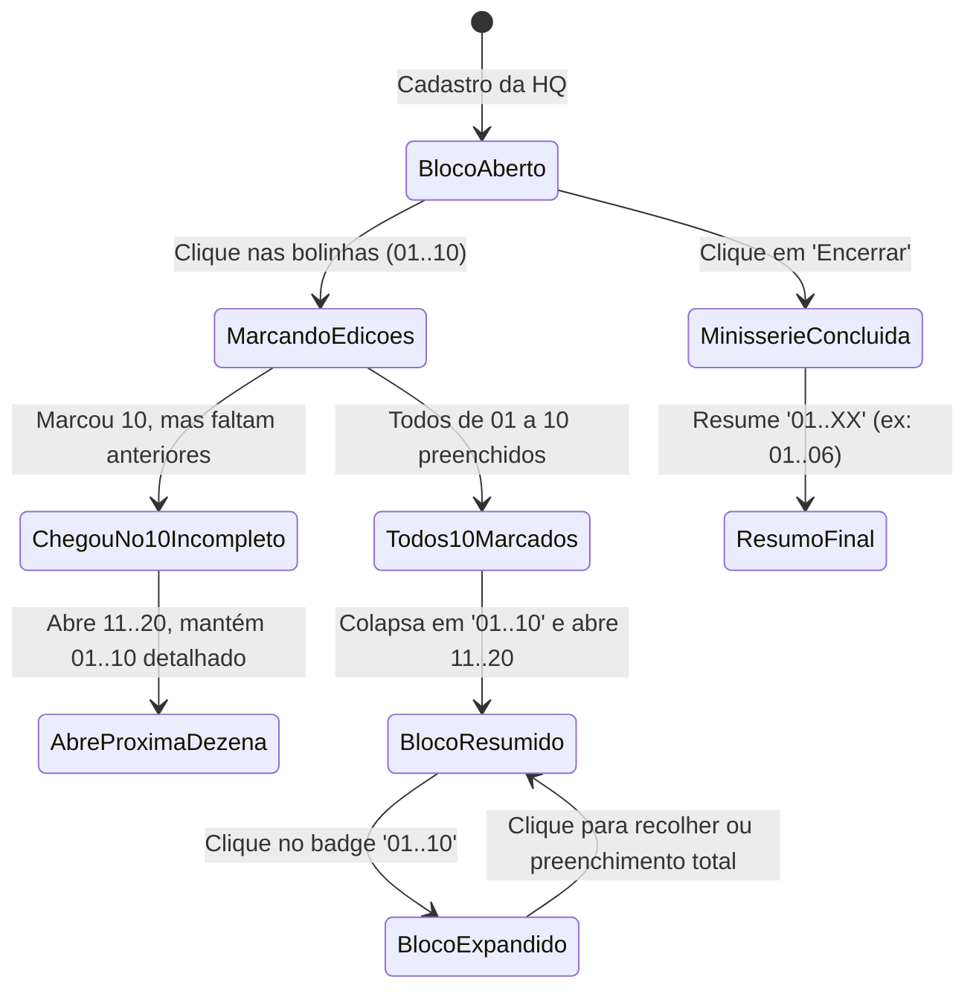

# 🏛️ Arquitetura do Sistema: HQ Tracker

## 1. Visão Geral
O **HQ Tracker** é um sistema projetado para colecionadores de quadrinhos com foco em extrema agilidade no ambiente mobile ("Mobile First"). A aplicação opera em **tela única**, minimizando cliques, eliminando navegações desnecessárias e agrupando edições em blocos táteis de 10 em 10.

---

## 2. Diagrama de Fluxo e Componentes



---

## 3. Lógica do Mecanismo de Chunking (10 em 10)



---

## 4. Estrutura de Pastas Padronizada

```text
/antigravity.collections
├── .env                          # Variáveis de ambiente (Firebase, GitHub)
├── firestore.rules               # Regras de segurança do Firestore
├── vercel.json                   # Configuração de publicação na Vercel
├── package.json                  # Scripts unificados de gerenciamento
├── README.md                     # Documentação profissional bilíngue
├── /directives                   # Camada 1: Diretivas Estratégicas (SOPs)
│   └── SOP_COLECOES_HQ.md
├── /execution                    # Camada 3: Scripts de Automação Determinística
│   ├── build_all.js
│   ├── deploy_github.js
│   ├── deploy_vercel.js
│   └── test_firebase.js
├── /documentation                # Documentação técnica e histórico
│   ├── architecture.md
│   ├── firebase_setup.md
│   └── promptHistory.md
├── /frontend                     # Aplicação Web Mobile First (React + Tailwind)
│   ├── .env
│   ├── package.json
│   ├── tailwind.config.js
│   └── src/
│       ├── App.jsx
│       ├── firebase.js
│       ├── index.css
│       └── main.jsx
└── /backend                      # API de Apoio (Node.js + Express)
    ├── package.json
    └── src/
        └── server.js
```

---
*Padrão de excelência técnica: Google Antigravity & SENAI Ourinhos Edition*

