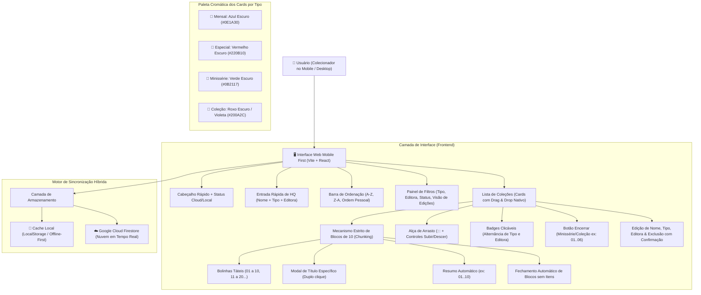
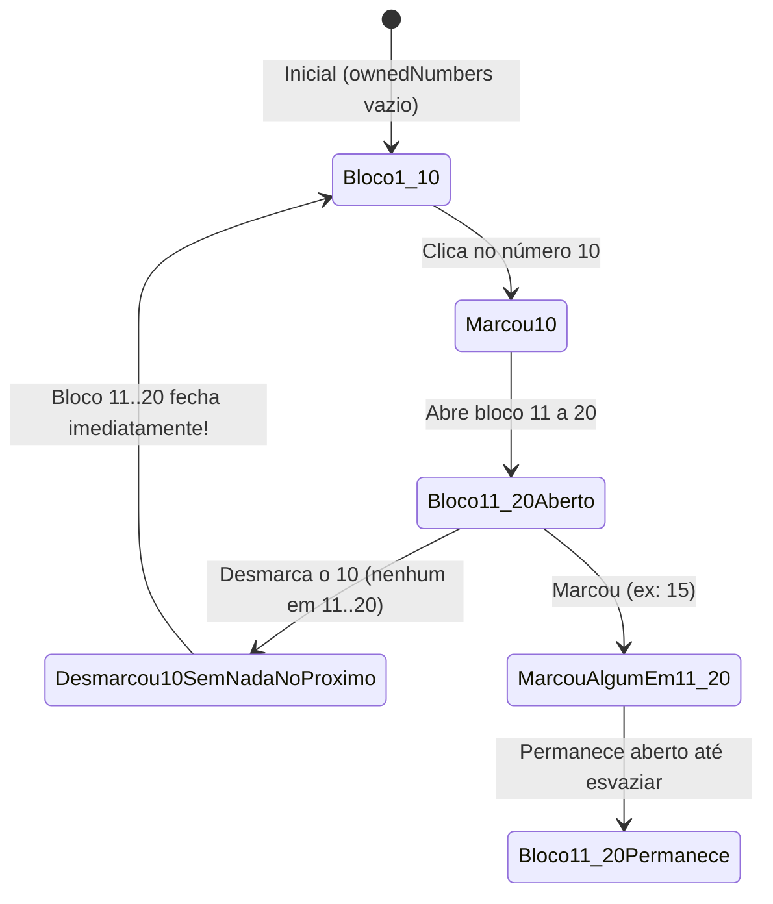

# 🏛️ Arquitetura do Sistema: HQ Tracker

## 1. Visão Geral
O **HQ Tracker** é um sistema projetado para colecionadores de quadrinhos com foco em extrema agilidade no ambiente mobile ("Mobile First"). A aplicação opera em **tela única**, minimizando cliques, eliminando navegações desnecessárias, agrupando edições em blocos táteis de 10 em 10, categorizando coleções por Tipo e Editora, e permitindo ordenação personalizada com **Drag & Drop** e títulos específicos por edição para Minisséries e Coleções.

---

## 2. Diagrama de Fluxo e Componentes

---

## 3. Lógica dos Modos de Ordenação

1. **A-Z:** Ordenação alfabética crescente baseada no nome da HQ.
2. **Z-A:** Ordenação alfabética decrescente baseada no nome da HQ.
3. **Ordem Pessoal (Drag & Drop):**
   * Cada card possui a propriedade `position: number`.
   * Ao arrastar e soltar um card usando a alça `:::`, a aplicação comuta imediatamente para o modo `Ordem Pessoal`, atualiza as posições de todos os cards e sincroniza no Firestore e LocalStorage via `saveAllComicsOrder`.
   * No mobile, além do arrasto tátil, há botões rápidos de subir (`↑`) e descer (`↓`) na alça.

---

## 4. Regra Estrita de Blocos Abertos (10 em 10)

---
*Padrão de excelência técnica: Google Antigravity & SENAI Ourinhos Edition*
