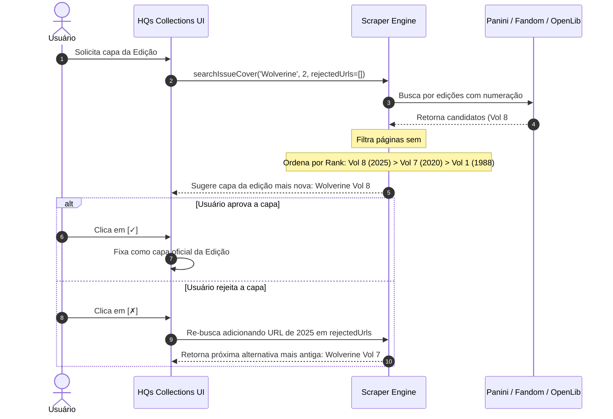

# 🏛️ Arquitetura do Sistema: HQs Collections `v1.3.0`

## 1. Visão Geral
O **HQs Collections** é um sistema projetado para colecionadores de quadrinhos com foco em extrema agilidade no ambiente mobile ("Mobile First"). A aplicação opera em **tela única**, minimizando cliques, eliminando navegações desnecessárias, agrupando edições em blocos táteis de 10 em 10, categorizando coleções por Tipo e Editora, permitindo ordenação personalizada com **Drag & Drop**, títulos específicos por fascículo, suporte a início em edições avançadas (`startFrom`), **ciclo interativo de 4 estágios com destaque em neon**, **scraper com prioridade cronológica decrescente (lançamentos 2025/2026 e maiores volumes primeiro)**, **validador estrito de número de edição (`matchIssueNumber`)**, **fallback progressivo para edições mais antigas ao rejeitar uma capa** e **ações em lote (Aceitar Todos / Rejeitar Todos) para curadoria ágil de capas pendentes**.

---

## 2. Diagrama de Fluxo e Componentes

```mermaid
flowchart TD
    User["📱 Usuário (Colecionador no Mobile / Desktop)"] --> UI["🖥️ Interface Web Mobile First (Vite + React)"]

    subgraph HeaderSection ["Cabeçalho e Navegação"]
        UI --> Brand["Logotipo + Versão v1.3.0 + Badge Mobile + Slogan"]
        UI --> CoverProgressBtn["Botão Tátil [🖼️ XX%] (Apenas Ícone e Porcentagem)"]
        UI --> ModeToggle["Alternador de Modo (Consulta 👁️ / Edição ✏️)"]
        UI --> ConnectionBadge["Status Conexão [☁️ Nuvem / 💾 Local] + Contadores [XX HQs • YY ed.]"]
    end

    subgraph CoverModalSection ["Modal de Status de Capas & Ações em Lote"]
        CoverProgressBtn --> CoverModal["Modal de Monitoramento Panini & Web"]
        CoverModal --> BatchActionsBar["Barra de Ações em Lote (Aceitar Todos / Rejeitar Todos)"]
        BatchActionsBar --> BatchApprove["Aceitar Todos: Fixa todas as pendentes via saveComicsBatch"]
        BatchActionsBar --> BatchReject["Rejeitar Todos: Rejeita pendentes e busca alternativas anteriores"]
        CoverModal --> TabsFilter["Abas: Todas | Encontradas | Em Busca | Sem Capa"]
    end

    subgraph ScraperEngine ["Motor de Busca Cronológico & Validador de Edições"]
        CoverProgressBtn --> BackgroundWorker["Worker Assíncrono em Segundo Plano"]
        BackgroundWorker --> ScraperEndpoint["/api/scrape-cover (Vercel Serverless / Backend Express)"]
        
        ScraperEndpoint --> StrictValidator["Validador matchIssueNumber(title, issueNum)"]
        StrictValidator --> YearFilter["Isola anos de 4 dígitos (ex: 2025/2026) da numeração"]
        StrictValidator --> VolumeDetector["Diferencia Volume de Edição (ex: Vol 8 #2)"]
        
        ScraperEndpoint --> ChronoRanker["Classificador Cronológico Decrescente"]
        ChronoRanker --> PaniniNewest["Panini Brasil: Anos 2026 > 2025 > 2024..."]
        ChronoRanker --> FandomVolRank["Fandom: Rank = (Volume * 10000) + Ano"]
        
        ScraperEndpoint --> AntiDuplicate["Garantia de Unicidade por Coleção (Sem repetição)"]
        ScraperEndpoint --> ProgressiveFallback["Fallback Progressivo: Rejeição busca próximo candidato mais antigo"]
    end

    subgraph ComicListSection ["Lista de Coleções (Cards com Drag & Drop Nativo)"]
        UI --> ComicList["Lista de Cards"]
        ComicList --> ChunkEngine["Mecanismo Estrito de Blocos de 10 (Chunking)"]
        ChunkEngine --> TactileCircles["Bolinhas Táteis em Linha Única (grid-cols-10)"]
        TactileCircles --> FourStageCycle["Ciclo de 4 Estágios (Owned -> Read -> Wishlist -> None)"]
        
        ChunkEngine --> IssueDetailModal["Modal de Detalhes da Edição (Modo Consulta)"]
        IssueDetailModal --> CoverFrame["Moldura Estética de Capa (2:3)"]
        IssueDetailModal --> TextFreeCurator["Curadoria Sem Texto: Aprovar [✓] e Rejeitar [✗]"]
    end

    subgraph DataSync ["Motor de Sincronização Híbrida"]
        UI --> StorageLayer["Camada de Armazenamento"]
        StorageLayer --> LocalStorage["💾 Cache Local (LocalStorage / Offline-First)"]
        StorageLayer --> Firestore["☁️ Google Cloud Firestore (Nuvem em Tempo Real)"]
    end
```

---

## 3. Lógica do Validador Estrito e Fallback Cronológico

---
*Padrão de excelência técnica: Google Antigravity & SENAI Ourinhos Edition*
