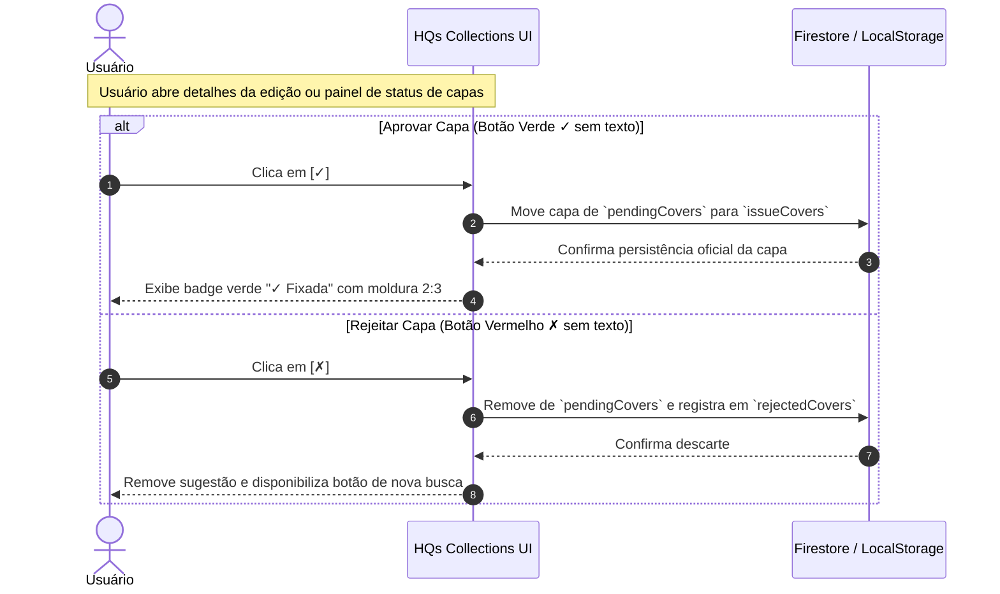

# 🏛️ Arquitetura do Sistema: HQs Collections `v1.2.0`

## 1. Visão Geral
O **HQs Collections** é um sistema projetado para colecionadores de quadrinhos com foco em extrema agilidade no ambiente mobile ("Mobile First"). A aplicação opera em **tela única**, minimizando cliques, eliminando navegações desnecessárias, agrupando edições em blocos táteis de 10 em 10, categorizando coleções por Tipo e Editora, permitindo ordenação personalizada com **Drag & Drop**, títulos específicos por fascículo, suporte a início em edições avançadas (`startFrom`), **ciclo interativo de 4 estágios com destaque em neon**, **scraper forçado na Panini Brasil via curl e serverless**, **painel detalhado de status de busca de capas** e **curadoria de capas sem texto (Aprovar ✓ / Rejeitar ✗)**.

---

## 2. Diagrama de Fluxo e Componentes

```mermaid
flowchart TD
    User["📱 Usuário (Colecionador no Mobile / Desktop)"] --> UI["🖥️ Interface Web Mobile First (Vite + React)"]

    subgraph HeaderSection ["Cabeçalho e Navegação"]
        UI --> Brand["Logotipo + Versão v1.2.0 + Badge Mobile + Slogan"]
        UI --> CoverProgressBtn["Botão Tátil [🖼️ XX%] (Apenas Ícone e Porcentagem)"]
        UI --> ModeToggle["Alternador de Modo (Consulta 👁️ / Edição ✏️)"]
        UI --> ConnectionBadge["Status Conexão [☁️ Nuvem / 💾 Local] + Contadores [XX HQs • YY ed.]"]
    end

    subgraph CoverDashboard ["Painel Detalhado de Status da Busca de Capas"]
        CoverProgressBtn --> CoverModal["Modal de Monitoramento de Capas"]
        CoverModal --> MetricsBar["Métricas: % Progresso, Buscadas, Fixadas, Pendentes"]
        CoverModal --> TabsFilter["Abas: Todas / Encontradas / Em Busca / Sem Capa & Rejeitadas"]
        CoverModal --> IssueSearchFilter["Filtro Instantâneo por Título da HQ"]
        CoverModal --> CoverApprovalAction["Aprovação e Rejeição Direta por Edição [✓] [✗]"]
    end

    subgraph ComicListSection ["Lista de Coleções (Cards com Drag & Drop Nativo)"]
        UI --> ComicList["Lista de Cards"]
        ComicList --> StartFromLogic["Ponto de Partida Customizado (startFrom)"]
        StartFromLogic --> HiddenChip["Chip de Dezenas Anteriores Ocultas (01..XX)"]
        StartFromLogic --> ActiveChunks["Dezenas Ativas a partir da Faixa Inicial"]
        
        ComicList --> ChunkEngine["Mecanismo Estrito de Blocos de 10 (Chunking)"]
        ChunkEngine --> TactileCircles["Bolinhas Táteis em Linha Única (grid-cols-10)"]
        TactileCircles --> FourStageCycle["Ciclo de 4 Estágios (Owned -> Read -> Wishlist -> None)"]
        
        ChunkEngine --> IssueDetailModal["Modal de Detalhes da Edição (Modo Consulta)"]
        IssueDetailModal --> CoverFrame["Moldura Estética de Capa (2:3)"]
        IssueDetailModal --> TextFreeCurator["Curadoria Sem Texto: Botão Aprovar [✓] e Botão Rejeitar [✗]"]
    end

    subgraph ScraperEngine ["Motor de Busca de Capas Forçado na Panini Brasil"]
        UI --> BackgroundWorker["Hook Assíncrono em Segundo Plano"]
        BackgroundWorker --> PaniniEndpoint["/api/scrape-cover (Vercel Serverless / Backend Express)"]
        PaniniEndpoint --> PaniniCurl["curl.exe em panini.com.br/catalogsearch/result/?q=..."]
        PaniniCurl --> PaniniHTML["Parser Magento 2 / Elasticsuite (HTML e Cloudfront)"]
        PaniniHTML --> QualityUpgrade["Elevação para Imagem Alta Resolução (-S600- ou JPEG 897x1373)"]
        PaniniEndpoint --> FallbackFandom["Fallback: Fandom MediaWiki (DC / Marvel / Vertigo)"]
        PaniniEndpoint --> FallbackOpenLib["Fallback: OpenLibrary API"]
    end

    subgraph DataSync ["Motor de Sincronização Híbrida"]
        UI --> StorageLayer["Camada de Armazenamento"]
        StorageLayer --> LocalStorage["💾 Cache Local (LocalStorage / Offline-First)"]
        StorageLayer --> Firestore["☁️ Google Cloud Firestore (Nuvem em Tempo Real)"]
    end
```

---

## 3. Fluxo de Curadoria de Capa (Aprovar ✓ vs. Rejeitar ✗)

---
*Padrão de excelência técnica: Google Antigravity & SENAI Ourinhos Edition*
