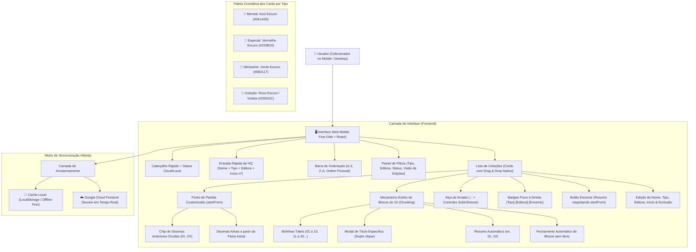
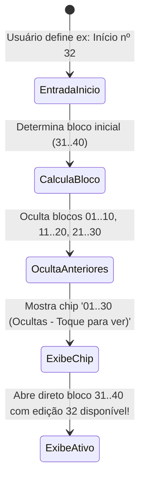

# 🏛️ Arquitetura do Sistema: HQ Tracker

## 1. Visão Geral
O **HQ Tracker** é um sistema projetado para colecionadores de quadrinhos com foco em extrema agilidade no ambiente mobile ("Mobile First"). A aplicação opera em **tela única**, minimizando cliques, eliminando navegações desnecessárias, agrupando edições em blocos táteis de 10 em 10, categorizando coleções por Tipo e Editora, permitindo ordenação personalizada com **Drag & Drop**, títulos específicos por fascículo e suporte a coleções que iniciam em edições avançadas (`startFrom`).

---

## 2. Diagrama de Fluxo e Componentes

---

## 3. Lógica do Ponto de Partida (`startFrom`)

---
*Padrão de excelência técnica: Google Antigravity & SENAI Ourinhos Edition*
